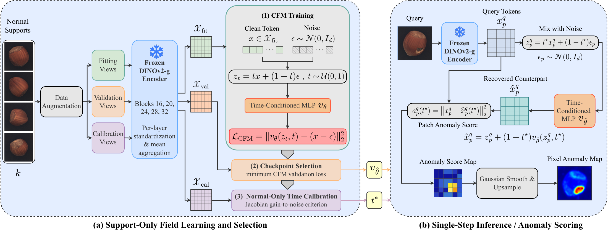
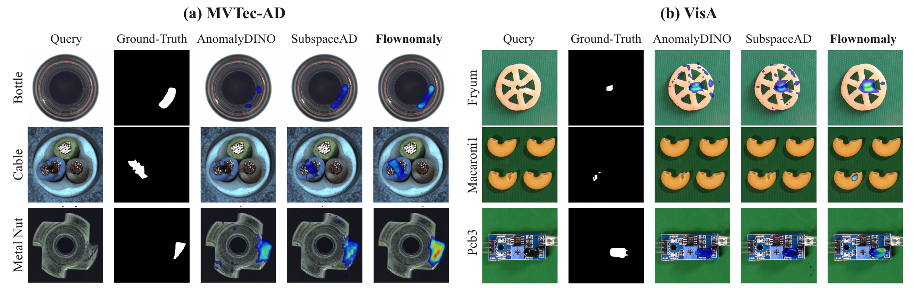

<h1 align="center"><a href="https://arxiv.org/pdf/2610.32964">Flownomaly: Single-Step Conditional-Mean Recovery for Few-Shot Anomaly Detection (WACV 2027)</a></h1>

<p align="center">Bernardo Perrone Ribeiro &middot; Erkut Akdag &middot; Egor Bondarev</p>

<p align="center">
  AIMS Group, Department of Electrical Engineering<br>
  Eindhoven University of Technology
</p>

<p align="center">Official implementation &middot; <a href="https://arxiv.org/pdf/2610.32964">arXiv</a></p>

---

<p align="center"></p>

<p><i>Figure 1. Flownomaly learns a conditional flow-matching field from normal support features, selects an operating time using normal-only calibration, and detects anomalies through single-step recovery residuals.</i></p>

## Introduction

Detecting visual anomalies in industrial inspection often requires learning normal appearance from only a few examples per category. **Flownomaly** formulates few-shot anomaly detection as single-step normal-counterpart recovery in frozen DINOv2 feature space.

Flownomaly consists of three stages:

1. **Feature Extraction:** Patch-level features are extracted from normal support images and their augmented views using a frozen **DINOv2** backbone.
2. **Field Learning:** A category-specific velocity network is trained with conditional flow matching, with checkpoint selection using normal validation views.
3. **Normal-Only Calibration:** A **Jacobian gain-to-noise (JGN)** criterion selects the operating time using normal calibration views.

At inference, query tokens are mixed with Gaussian noise and recovered in a single step. The recovery residual provides image-level anomaly scores and pixel-level localization maps. Flownomaly achieves state-of-the-art few-shot results on VisA and Real-IAD and leads most comparisons on MVTec-AD.

**Main Results (1-Shot)**

- **MVTec-AD:** 97.8% Image AUROC; 98.0% Pixel AUROC
- **VisA:** 95.3% Image AUROC; 98.7% Pixel AUROC
- **Real-IAD (1 sample, 5 views):** 88.2% Image AUROC; 99.2% Pixel AUROC

---

<p align="center"></p>

<p><i>Figure 2. Qualitative comparison on MVTec-AD (left) and VisA (right) in the 1-shot setting, showing query images, ground-truth masks, and anomaly maps from AnomalyDINO, SubspaceAD, and Flownomaly.</i></p>

## Environment Setup

Install [uv](https://docs.astral.sh/uv/getting-started/installation/), then:

```bash
git clone https://github.com/b-rbmp/Flownomaly.git
cd Flownomaly
uv sync --frozen
```

The environment uses Python 3.11 and requires an NVIDIA CUDA GPU for training, inference, and pixel-level evaluation. The paper experiments ran on Linux with an NVIDIA H100. DINOv2 weights are downloaded automatically on first use.

## Data Preparation

### MVTec-AD

Download [MVTec-AD](https://www.mvtec.com/research-teaching/datasets/mvtec-ad) and extract it to `datasets/mvtec-ad/`, with category folders directly inside it.

### VisA

Download the raw [VisA dataset](https://github.com/amazon-science/spot-diff) and extract it to `datasets/VisA/`. The loader uses `split_csv/1cls.csv`; no preprocessing is required.

### Real-IAD

Download the **1024-pixel images** and category JSON files from [Real-IAD](https://realiad4ad.github.io/Real-IAD/) into `datasets/Real-IAD/`, following the structure below.

## Folder Structure

```text
Flownomaly/
├── datasets/
│   ├── mvtec-ad/<category>/{train,test,ground_truth}/
│   ├── VisA/
│   │   ├── split_csv/1cls.csv
│   │   └── <category>/Data/{Images,Masks}/
│   └── Real-IAD/
│       ├── realiad_1024/<category>/
│       └── realiad_jsons/<category>.json
├── results/                    # Checkpoints, anomaly maps, and metrics
├── assets/                     # Paper figures
├── src/flownomaly/              # Method, dataset loaders, and evaluation
│   └── cli/                    # Training, inference, and evaluation commands
├── pyproject.toml
├── uv.lock
└── README.md
```

## Usage

This release reproduces the main MVTec-AD/VisA results and the Real-IAD sample-shot results under **1-, 2-, and 4-shot** protocols. Each command runs all categories and three seeds (`42 43 44`) by default.

### Manual Execution

Example: 1-shot MVTec-AD. Run the three commands in order:

```bash
uv run flownomaly-train \
    --dataset mvtec --data-root datasets/mvtec-ad --shot 1 --output-root results

uv run flownomaly-infer \
    --dataset mvtec --data-root datasets/mvtec-ad --shot 1 --output-root results

uv run flownomaly-evaluate \
    --dataset mvtec --data-root datasets/mvtec-ad --shot 1 --output-root results
```

Change the dataset arguments as follows:

| Dataset | `--dataset` | `--data-root` | Meaning of `--shot` |
| --- | --- | --- | --- |
| MVTec-AD | `mvtec` | `datasets/mvtec-ad` | Normal images per category |
| VisA | `visa` | `datasets/VisA` | Normal images per category |
| Real-IAD | `realiad` | `datasets/Real-IAD` | Normal physical samples per category, with 5 views each |

### All Shot Settings

For example, to run all three shot settings on MVTec-AD:

```bash
for shot in 1 2 4; do
    for phase in train infer evaluate; do
        uv run "flownomaly-$phase" \
            --dataset mvtec --data-root datasets/mvtec-ad \
            --shot "$shot" --output-root results
    done
done
```

Use either example for a given run; use a fresh `--output-root` when rerunning. To run a single seed, add `--seeds 42` to each command. Model and protocol defaults are defined in [protocol.py](src/flownomaly/protocol.py).

Checkpoints, anomaly maps, and `metrics_summary.{json,md}` are saved under `results/<dataset>/<shot>-image-shot/`, or `<shot>-sample-shot/` for Real-IAD.

## Benchmark Results

Results are AUROC percentages (mean ± standard deviation over three seeds, after averaging across categories).

### Few-Shot: MVTec-AD and VisA

| Setting | MVTec-AD Image AUROC | MVTec-AD Pixel AUROC | VisA Image AUROC | VisA Pixel AUROC |
| --- | ---: | ---: | ---: | ---: |
| **1-Shot** | 97.8 ± 0.9 | 98.0 ± 0.1 | 95.3 ± 0.7 | 98.7 ± 0.0 |
| **2-Shot** | 98.4 ± 0.5 | 98.3 ± 0.0 | 96.1 ± 0.3 | 98.9 ± 0.0 |
| **4-Shot** | 98.5 ± 0.4 | 98.4 ± 0.1 | 96.3 ± 0.4 | 99.0 ± 0.0 |

### Sample-Shot: Real-IAD

Each support sample contributes five camera views. Detection is evaluated per image.

| Setting | Support Images | Image AUROC | Pixel AUROC |
| --- | ---: | ---: | ---: |
| **1-Sample-Shot** | 5 | 88.2 ± 0.2 | 99.2 ± 0.0 |
| **2-Sample-Shot** | 10 | 88.7 ± 0.1 | 99.2 ± 0.0 |
| **4-Sample-Shot** | 20 | 89.5 ± 0.2 | 99.2 ± 0.0 |

## Citation

If you find this repository useful, please consider citing:

```bibtex
To be added.
```

## Acknowledgements

This work is supported by the STRUCTURE ITEA 24017 project.
